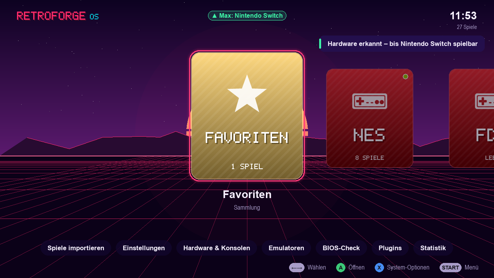
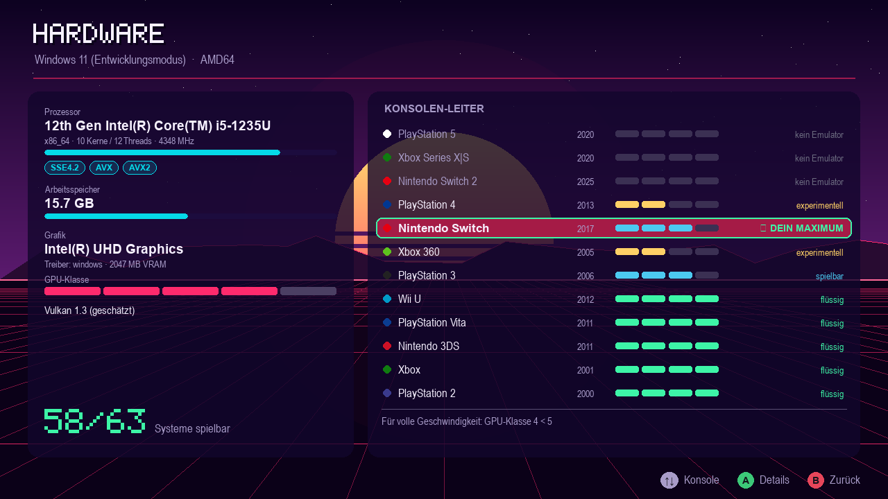
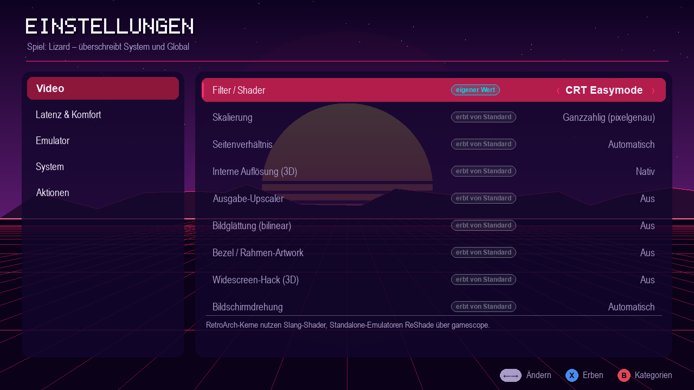
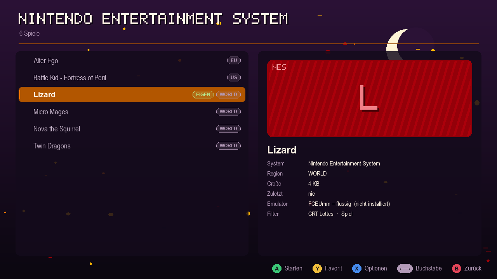
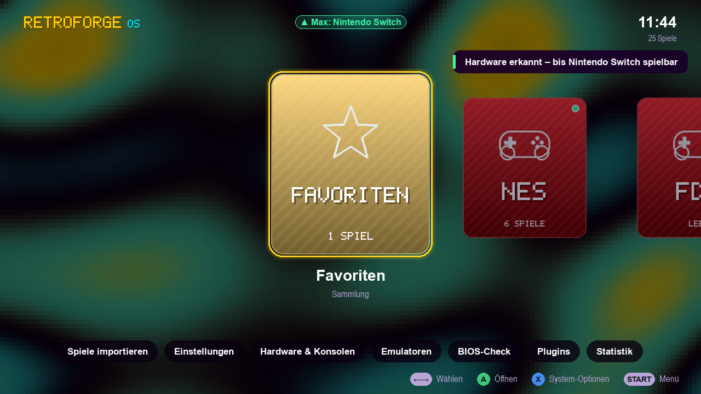

# RetroForge OS

[](https://github.com/Karl-Lauterbach24/retroforge-os/actions/workflows/ci.yml)
[](https://github.com/Karl-Lauterbach24/retroforge-os/releases)
[](LICENSE)

Ein schlankes Retro-Gaming-Betriebssystem: Einschalten, Controller nehmen, spielen.
Es basiert auf Debian. Die Oberfläche läuft direkt auf KMS/DRM, also ohne Desktop, X11 oder Wayland.
Über 60 Systeme vom Atari 2600 bis zur Switch werden unterstützt, und **alles** lässt sich per Plugin erweitern.



## Highlights

| | |
|---|---|
| **Hardware-Leiter** | Beim Start werden CPU (Takt × IPC-Schätzung, AVX/AVX2/NEON), GPU (Klasse 0–5, Treiber, VRAM), Vulkan-Version und RAM erkannt. Daraus berechnet das System für jede Konsole den Status *flüssig / spielbar / experimentell / nicht möglich* und zeigt die **höchste lauffähige Konsole** an. Dazu kommt das **nächste Ziel** samt Begründung, z. B. „PS4: CPU-Befehlssatz AVX2 fehlt“. |
| **Einstellungen in 3 Ebenen** | Global → pro System → pro Spiel. Dazu gehören Shader/Filter (CRT-Royale, CRT-Lottes, CRT-Geom, Scanlines, LCD-Raster, Game-Boy-Punktmatrix, xBRZ, ScaleFX …), Skalierung (ganzzahlig, einpassen, strecken), Seitenverhältnis, **interne 3D-Auflösung (Upscaling)**, FSR/NIS-Upscaler, Run-Ahead, Rewind, Auto-Save, Bildschirmdrehung (TATE), Grafik-API, VRR, CPU-Profil und Emulatorwahl. Jede Zeile zeigt an, von wo sie ihren Wert *erbt*. |
| **Filter auch für Standalone-Emulatoren** | RetroArch-Kerne bekommen Slang-Shader. Dolphin, PCSX2, RPCS3 usw. laufen in **gamescope** und bekommen darüber FSR, NIS, Pixel-Art-Scaling und ReShade-CRT-Effekte. |
| **ROMs direkt im OS laden** | USB-Stick einstecken, dann *Spiele importieren*. Header-Erkennung (NES, GB/GBC, GBA, NDS, N64, Mega Drive, PS1/PS2/PSP-ISOs, GameCube/Wii, Switch, 3DS …) sortiert die Dateien automatisch ein, BIOS-Dateien landen in `bios/`. Alternativ per **Web-Upload vom Handy** (PIN-geschützt) oder über die exFAT-Partition am PC. |
| **Themes** | 6 eingebaute Themes (Synthwave, Phosphor-Terminal, Game Boy, Famicom (hell), Midnight, Demoscene-Plasma) und 2 Saison-Themes per Plugin. Alles ist prozedural, es gibt keine Asset-Dateien. |
| **Musik & Sounds** | Jedes Theme erzeugt **seine eigene Chiptune-Musik** (Tempo, Tonart, Akkordfolge aus dem Theme-JSON, deterministisch und gecacht). Alternativ läuft eigene Musik aus `/userdata/music` (Playlist oder Zufall). Es gibt 3 Menü-Soundpacks; die Musik wird im Spiel ausgeblendet. |
| **Plugins für alles** | Systeme, Emulatoren, Shader, Settings, Themes, Hintergründe, Sound-Packs, Screens, Menüeinträge, Sammlungen und ROM-Detektoren. Dazu kommen Hooks wie `game.before_launch` (Startbefehl umbauen), `hw.probed` und `ui.idle`. Der Kern registriert seine eigenen Inhalte über dieselbe API, deshalb ist jedes Built-in ersetzbar. |
| **Leicht & schnell** | Frontend in Python + SDL2 (pygame), 3–9 ms pro Frame in Software. Auf schwacher Hardware gelten automatisch 30 fps. Im Energiesparmodus wird ohne Eingabe nicht neu gezeichnet. Emulatoren werden bei Bedarf geladen, deshalb bleibt das Basis-Image klein. Logs liegen im RAM (schont SD-Karten), dazu kommen zram-Swap und ein CPU-Governor pro Spiel. |

Weitere Ideen, die schon drin sind: **Empfohlene Filter für deine GPU** per Klick, **BIOS-Check**, Multi-Disc über `.m3u`, Region-Badges, Cover-Unterstützung (`roms/<system>/images/<name>.png`), Favoriten, „Zuletzt gespielt“, Statistik, Spielstand-Backups vor jedem Start, RetroAchievements, Bildschirmschoner mit Spielvorschlägen, Tippen-zum-Suchen sowie Gamepad-Hotplug mit SDL-GameController-Mapping (Xbox, PlayStation, Switch Pro, 8BitDo …).

<p>
 
 
</p>

## Ausprobieren (Windows/macOS/Linux, ohne Image)

```bash
git clone https://github.com/Karl-Lauterbach24/retroforge-os.git && cd retroforge-os
pip install pygame-ce
python tools/make_demo_library.py            # legt ./userdata mit Demo-Dateien an
python -m retroforge --windowed              # Frontend im Fenster
python -m retroforge --probe                 # Hardware-Bericht + Konsolen-Leiter im Terminal
python -m unittest discover tests            # 16 Tests
```

Steuerung per Tastatur: Pfeiltasten, **Enter** = A, **Esc** = B, **Tab** = X (Optionen), **F2** = Y (Favorit), **F1** = Start (Menü), **Bild↑/↓** = L/R. Buchstaben tippen startet die Suche. Gamepads funktionieren sofort.

## OS-Image bauen

> **Status 0.1.0:** Der Image-Build ist noch experimentell und nicht auf echter Hardware verifiziert.
> Er lässt sich auch direkt auf GitHub starten: *Actions → Build OS image → Run workflow*.

```bash
docker build -t retroforge-builder os/
docker run --rm --privileged -v "$PWD":/src retroforge-builder pc-x86_64            # klein, Emulatoren on demand
docker run --rm --privileged -v "$PWD":/src retroforge-builder rpi-arm64 --bundle   # alles offline dabei
```

| Profil | Zielgeräte | Basis |
|---|---|---|
| `pc-x86_64` | Jeder 64-Bit-PC ab ~2008, Laptops, Mini-PCs, Handhelds (Steam Deck, ROG Ally, Legion Go) | Debian 13, BIOS + UEFI 64/32-Bit in einem Image |
| `pc-i686` | 32-Bit-PCs (Pentium 4, Atom, frühe Core) | Debian 12 (letzte Version mit i386-Kernel) |
| `arm64-uefi` | Snapdragon X, RK3588 (Orange Pi 5, Rock 5) mit EDK2, Ampere, VMs | Debian 13 |
| `rpi-arm64` | Raspberry Pi 3/4/400/5/500, CM4/CM5 | Debian 13 + Raspberry-Pi-Kernel |
| `rpi-armhf` | Pi Zero/1/2/3 (32-Bit) | Raspberry Pi OS armhf |
| `riscv64` | VisionFive 2, Milk-V, QEMU (experimentell) | Debian 13 |

**Treiber:** Debians Kernel mit allen Modulen und Mesa (Intel i915/xe, AMD radeon/amdgpu, nouveau/NVK, VideoCore, Mali Lima/Panfrost/Panthor, Adreno, Vivante, virgl/venus). Dazu kommt die komplette non-free-Firmware für GPUs, WLAN, Bluetooth, Audio-DSPs und Microcode. NVIDIA wird **bei jedem Boot automatisch gewählt**: ab Turing der offene NVIDIA-Treiber, ältere Karten laufen über nouveau. Hybrid-Laptops rendern auf der dedizierten GPU. Das GRUB-Menü enthält einen *sicheren Grafikmodus* und einen *Wartungsmodus*.

**Partitionen:** `RF-BOOT` (FAT32), `RF-ROOT` (ext4 ohne Journal, schont SD-Karten) und `RETROFORGE` (**exFAT**). Die exFAT-Partition wächst beim ersten Start auf die ganze Platte und lässt sich an jedem Windows-PC oder Mac direkt mit ROMs, BIOS und Musik befüllen.

## Aufbau

```
retroforge/            Kern (UI-frei, auch headless nutzbar)
  core.py              verbindet alles; boot(), probe(), Bibliothek, Launcher
  registry.py          Registry + Event-Bus  ← Erweiterungspunkt für alles
  settings.py          Schichten global < system < spiel, atomar gespeichert
  hw/probe.py          /proc, /sys, vulkaninfo (Windows/macOS für Entwicklung)
  hw/tiers.py          CPU-Score, GPU-Klasse, Urteil pro Emulator/System, Leiter
  builtin/             Systeme, Emulatoren (min./empf. Anforderungen), Shader, Settings
  launcher.py          LaunchPlan → RetroArch-Append-Config / Core-Options / INI-Patches / gamescope
  emumanager.py        Emulatoren finden & bei Bedarf laden (libretro-Buildbot, GitHub-Releases)
  romdetect.py         Header-Magie + Dateiendungen
  ui/                  pygame-Frontend: Screens, Themes, Hintergründe, Synth-Audio, Eingabe
themes/<id>/theme.json Themes (Farben, Hintergrund, Schrift, Musik-Parameter, Soundpack)
plugins/<id>/          mitgelieferte Plugins (Statistik, Backup, Web-Upload, Schoner, RA, Saison)
os/                    Image-Build: Profile, Paketlisten, rootfs-Overlay, Bootloader
tools/                 Demo-Bibliothek, Headless-Screenshots
```

Mehr dazu: [Plugins schreiben](docs/PLUGINS.md) · [Themes erstellen](docs/THEMES.md)

## Ehrliche Grenzen (Stand Oktober 2026)

- **PS5, Xbox Series und Switch 2** sind als Systeme angelegt, aber **es gibt keinen lauffähigen Emulator**. Die Leiter zeigt sie deshalb als „kein Emulator“. Sobald es einen gibt, reicht ein Plugin mit `add_emulator()` und `add_emulator_to_system()`. Ein Unit-Test zeigt genau das am Beispiel PS5.
- **PS4 (shadPS4)** und **Xbox 360 (Xenia unter Linux)** sind als *experimentell* markiert.
- Für Switch-Emulatoren gibt es keinen stabilen öffentlichen Download-Kanal. Sie werden deshalb als AppImage nach `/userdata/emulators` kopiert. **ROMs, BIOS, Firmware und Keys liefert das System nicht mit**, du brauchst deine eigenen Dumps.
- Die Anforderungswerte in `builtin/emulators.py` sind konservative Schätzungen, und die Leistungsklasse lässt sich in den Einstellungen manuell erzwingen.
- Frontend, Kernlogik, Plugins und Tests liefen unter Windows: 16 Unit-Tests sowie ein Headless-UI-Durchlauf in allen 8 Themes. **Den Image-Build (`os/`) konnte ich hier nicht ausführen**, weil auf dem Rechner kein Linux, Docker oder WSL verfügbar war. Paketnamen, Shader-Pfade und Release-Asset-Muster sollten beim ersten echten Build geprüft werden. Unbekannte Pakete werden übersprungen, statt den Build abzubrechen.

## Roadmap-Ideen

Netplay-Lobby · Achievements-Overlay · Scraper-Plugin (ScreenScraper/IGDB) für Cover & Videos · Video-Vorschauen (Attract-Mode) · WLAN/Bluetooth-Pairing-Screen · Bildschirmtastatur · A/B-Systemupdates · Cloud-Sync der Spielstände (Syncthing-Plugin) · Lightgun-Kalibrierung (Sinden/Gun4IR) · Mehrsprachigkeit

## Lizenz

RetroForge OS steht unter der [GNU Affero General Public License v3.0](LICENSE). Wer eine veränderte Version
weitergibt **oder als Netzwerkdienst anbietet**, muss den Quellcode seiner Änderungen unter derselben Lizenz offenlegen.
Emulatoren, Firmware und Debian-Pakete im Image behalten ihre eigenen Lizenzen. ROMs, BIOS-Dateien und Keys sind
nicht enthalten.
