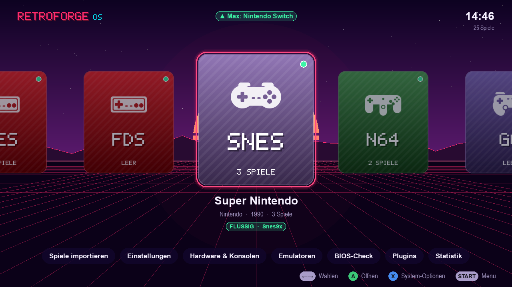
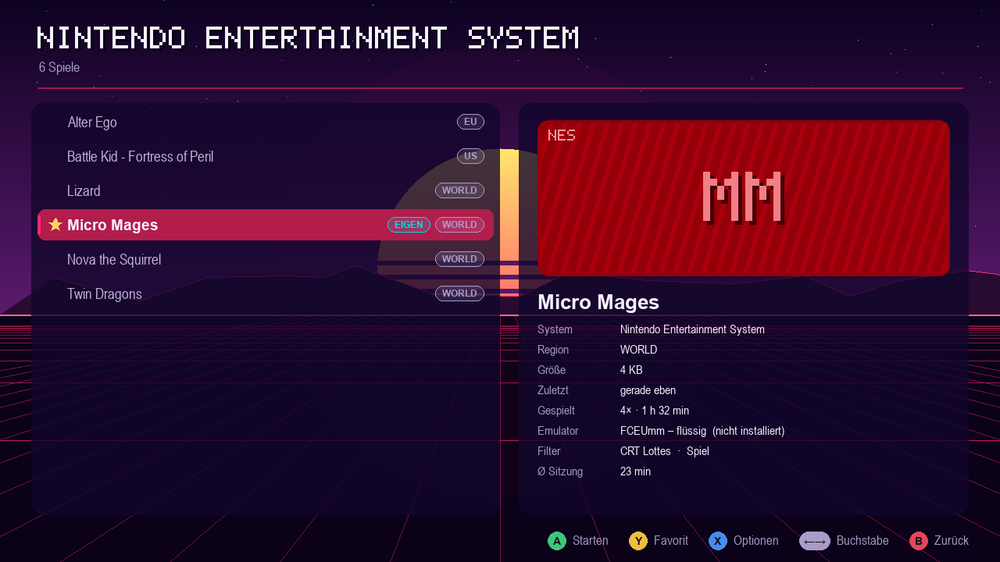
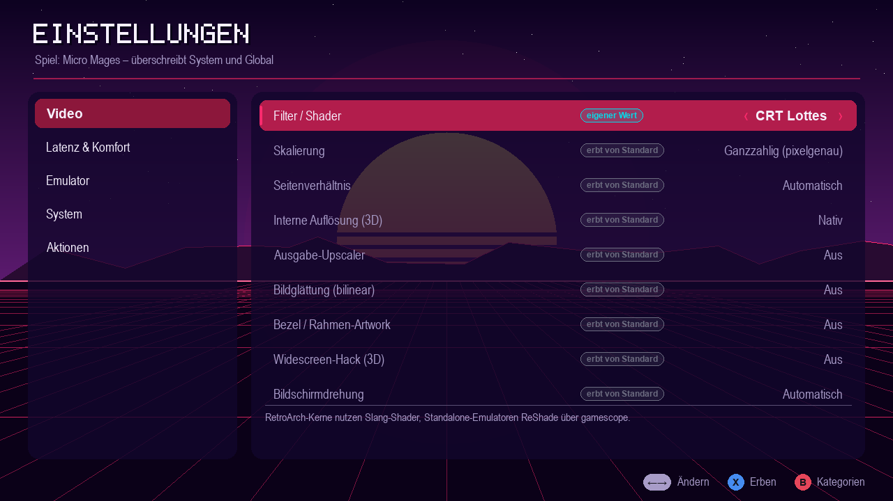
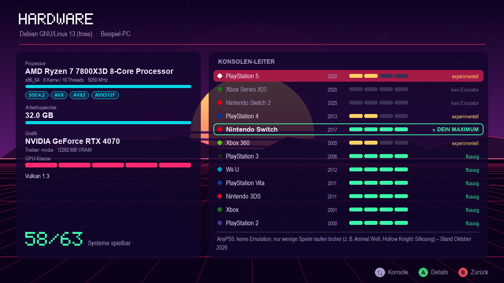
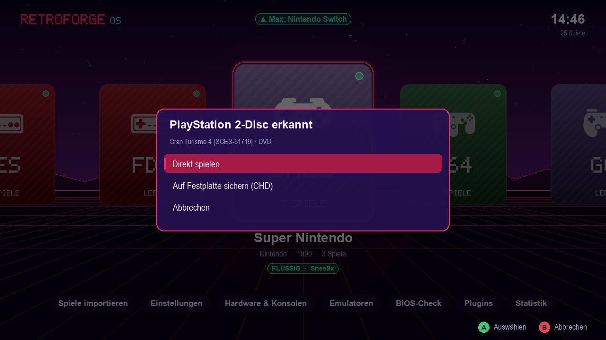
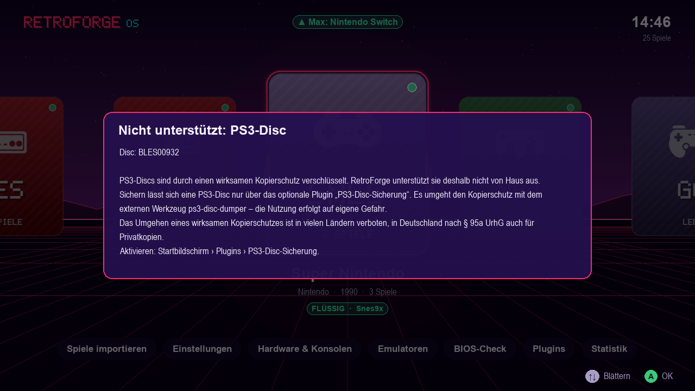
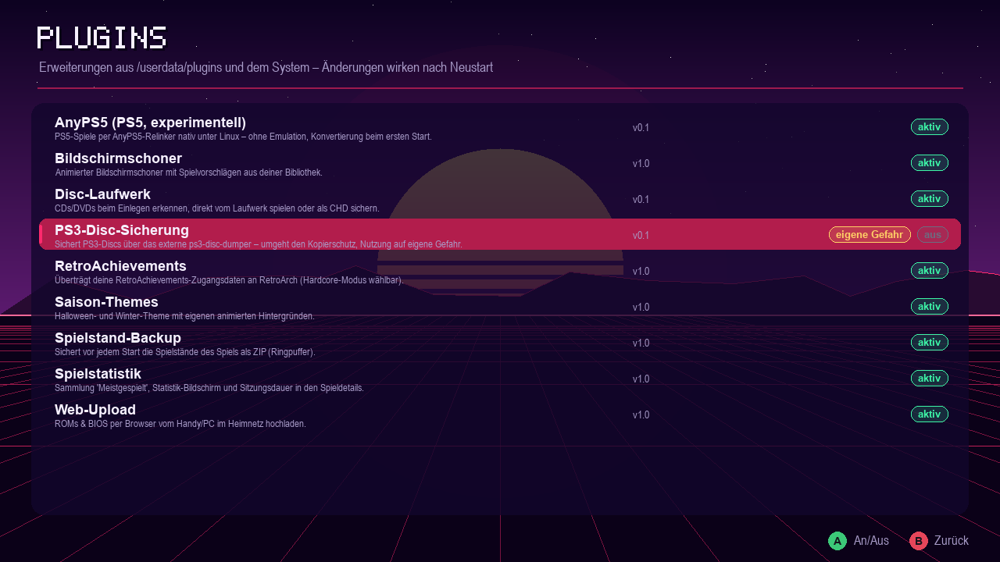
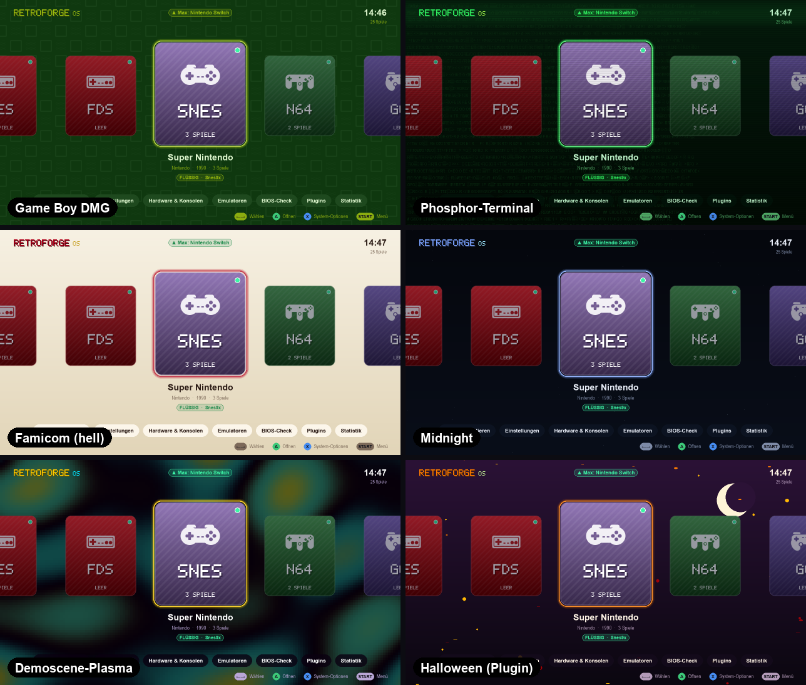

# RetroForge OS

[](https://github.com/Karl-Lauterbach24/retroforge-os/actions/workflows/ci.yml)
[](https://github.com/Karl-Lauterbach24/retroforge-os/releases/latest)
[](https://github.com/Karl-Lauterbach24/retroforge-os/releases)
[](LICENSE)

Ein schlankes Retro-Gaming-Betriebssystem: Einschalten, Controller nehmen, spielen.
Es basiert auf Debian. Die Oberfläche läuft direkt auf KMS/DRM, also ohne Desktop, X11 oder Wayland.
Über 60 Systeme vom Atari 2600 bis zur Switch werden unterstützt, PS5 experimentell. **Alles** lässt sich per Plugin erweitern.



## Herunterladen & installieren

Fertige Images für **Version 0.1.2** (alle Versionen unter [Releases](https://github.com/Karl-Lauterbach24/retroforge-os/releases)):

| Image | Für | Größe |
|---|---|---|
| [**pc-x86_64**](https://github.com/Karl-Lauterbach24/retroforge-os/releases/download/v0.1.2/retroforge-0.1.2-pc-x86_64.img.xz) | 64-Bit-PCs, Laptops, Mini-PCs, Handhelds (Steam Deck, ROG Ally …) – BIOS und UEFI | 1,0 GB |
| [**pc-i686**](https://github.com/Karl-Lauterbach24/retroforge-os/releases/download/v0.1.2/retroforge-0.1.2-pc-i686.img.xz) | 32-Bit-PCs (Pentium 4, Atom, frühe Core) | 645 MB |
| [**rpi-arm64**](https://github.com/Karl-Lauterbach24/retroforge-os/releases/download/v0.1.2/retroforge-0.1.2-rpi-arm64.img.xz) | Raspberry Pi 3 / 4 / 400 / 5 / 500, CM4 / CM5 | 680 MB |
| [**rpi-armhf**](https://github.com/Karl-Lauterbach24/retroforge-os/releases/download/v0.1.2/retroforge-0.1.2-rpi-armhf.img.xz) | Raspberry Pi Zero / 1 / 2 / 3 (32 Bit) | 622 MB |
| [**arm64-uefi**](https://github.com/Karl-Lauterbach24/retroforge-os/releases/download/v0.1.2/retroforge-0.1.2-arm64-uefi.img.xz) | ARM64 mit UEFI: RK3588 mit EDK2 (Orange Pi 5, Rock 5), Snapdragon X, Ampere, VMs | 612 MB |
| [**riscv64**](https://github.com/Karl-Lauterbach24/retroforge-os/releases/download/v0.1.2/retroforge-0.1.2-riscv64.img.xz) | RISC-V mit UEFI (VisionFive 2, Milk-V, QEMU) – experimentell | 674 MB |

1. **Flashen** mit [Raspberry Pi Imager](https://www.raspberrypi.com/software/) („Eigenes Image“), [balenaEtcher](https://etcher.balena.io/)
   oder `xzcat retroforge-0.1.2-<profil>.img.xz | sudo dd of=/dev/sdX bs=4M status=progress`.
   SHA-256-Prüfsummen liegen als `.sha256` neben jedem Image.
2. **Booten.** Beim ersten Start wächst die Datenpartition **RETROFORGE** auf die ganze Karte bzw. Platte.
3. **Spiele drauf:** Die Partition ist **exFAT** und lässt sich an jedem Windows-PC oder Mac öffnen; ROMs gehören nach
   `roms/<system>/` (jeder Ordner enthält eine `_info.txt` mit den Dateitypen), BIOS-Dateien nach `bios/`.
   Alternativ: USB-Stick einstecken › *Spiele importieren*, **Web-Upload** vom Handy oder **CD/DVD einlegen**.

> **Stand 0.1.2:** Alle Images werden automatisch gebaut und auf startfähige Boot-Dateien geprüft, wurden aber
> **noch auf keiner echten Hardware gestartet.** Erfahrungsberichte – auch „bootet nicht“ – helfen sehr:
> [Hardware-Bericht anlegen](https://github.com/Karl-Lauterbach24/retroforge-os/issues/new?template=hardware-report.md).

## Highlights

| | |
|---|---|
| **Hardware-Leiter** | Beim Start werden CPU (Takt × IPC-Schätzung, AVX/AVX2/NEON), GPU (Klasse 0–5, Treiber, VRAM), Vulkan-Version und RAM erkannt. Daraus berechnet das System für jede Konsole den Status *flüssig / spielbar / experimentell / nicht möglich* und zeigt die **höchste lauffähige Konsole** an. Dazu kommt das **nächste Ziel** samt Begründung, z. B. „PS4: CPU-Befehlssatz AVX2 fehlt“. |
| **Einstellungen in 3 Ebenen** | Global → pro System → pro Spiel. Dazu gehören Shader/Filter (CRT-Royale, CRT-Lottes, CRT-Geom, Scanlines, LCD-Raster, Game-Boy-Punktmatrix, xBRZ, ScaleFX …), Skalierung, Seitenverhältnis, **interne 3D-Auflösung (Upscaling)**, FSR/NIS-Upscaler, Run-Ahead, Rewind, Auto-Save, Bildschirmdrehung (TATE), Grafik-API, VRR, CPU-Profil und Emulatorwahl. Jede Zeile zeigt an, von wo sie ihren Wert *erbt*. |
| **Filter auch für Standalone-Emulatoren** | RetroArch-Kerne bekommen Slang-Shader. Dolphin, PCSX2, RPCS3 usw. laufen in **gamescope** und bekommen darüber FSR, NIS, Pixel-Art-Scaling und ReShade-CRT-Effekte. Debian 13 enthält gamescope nicht; ohne gamescope starten sie im schlanken Wayland-Kiosk **cage**, dann ohne diese Filter. |
| **ROMs direkt im OS laden** | USB-Stick einstecken, dann *Spiele importieren*. Header-Erkennung (NES, GB/GBC, GBA, NDS, N64, Mega Drive, PS1/PS2/PSP-ISOs, GameCube/Wii, Switch, 3DS …) sortiert die Dateien automatisch ein, BIOS-Dateien landen in `bios/`. Alternativ per **Web-Upload vom Handy** (PIN-geschützt) oder über die exFAT-Partition am PC. |
| **Spiele von Disc** | CD oder DVD einlegen: RetroForge erkennt das System (PS1, PS2, Saturn, Mega-CD, PC Engine CD, PC-FX, 3DO, PC-CD-ROMs) und bietet **Direkt spielen** oder **Als CHD sichern** an, auf Wunsch mit Redump-Abgleich und richtigem Spielnamen. Nicht unterstützte Discs bekommen eine klare Meldung mit Begründung. [Details](plugins/disc/README.md) |
| **PS5 experimentell** | Über das Plugin [AnyPS5](plugins/anyps5/README.md): kein Emulator, sondern ein Relinker, der PS5-Programme nativ unter Linux startet. Konvertierung beim ersten Start, Stand Oktober 2026 laufen nur wenige Spiele. |
| **Themes** | 6 eingebaute Themes (Synthwave, Phosphor-Terminal, Game Boy, Famicom (hell), Midnight, Demoscene-Plasma) und 2 Saison-Themes per Plugin. Alles ist prozedural, es gibt keine Asset-Dateien. |
| **Musik & Sounds** | Jedes Theme erzeugt **seine eigene Chiptune-Musik** (Tempo, Tonart, Akkordfolge aus dem Theme-JSON, deterministisch und gecacht). Alternativ läuft eigene Musik aus `/userdata/music` (Playlist oder Zufall). Es gibt 3 Menü-Soundpacks; die Musik wird im Spiel ausgeblendet. |
| **Plugins für alles** | Systeme, Emulatoren, Shader, Settings, Themes, Hintergründe, Sound-Packs, Screens, Menüeinträge, Sammlungen, ROM-Detektoren und Disc-Aktionen. Dazu kommen Hooks wie `game.before_launch` (Startbefehl umbauen), `hw.probed` und `ui.idle`. Der Kern registriert seine eigenen Inhalte über dieselbe API, deshalb ist jedes Built-in ersetzbar. |
| **Leicht & schnell** | Frontend in Python + SDL2 (pygame), 3–9 ms pro Frame in Software. Auf schwacher Hardware gelten automatisch 30 fps. Im Energiesparmodus wird ohne Eingabe nicht neu gezeichnet. Emulatoren werden bei Bedarf geladen, deshalb bleibt das Basis-Image klein. Logs liegen im RAM (schont SD-Karten), dazu kommen zram-Swap und ein CPU-Governor pro Spiel. |

Weitere Ideen, die schon drin sind: **Empfohlene Filter für deine GPU** per Klick, **BIOS-Check**, Multi-Disc über `.m3u`, Region-Badges, Cover-Unterstützung (`roms/<system>/images/<name>.png`), Favoriten, „Zuletzt gespielt“, Statistik, Spielstand-Backups vor jedem Start, RetroAchievements, Bildschirmschoner mit Spielvorschlägen, Tippen-zum-Suchen sowie Gamepad-Hotplug mit SDL-GameController-Mapping (Xbox, PlayStation, Switch Pro, 8BitDo …).

## Bilder

| | |
|---|---|
|  |  |
| Spieleliste: Favorit, Region, Spielzeit, Filter pro Spiel | Einstellungen pro Spiel – jede Zeile zeigt, woher ihr Wert kommt |
|  |  |
| Hardware-Leiter (Beispiel-PC): Switch als Maximum, PS5 experimentell | Disc eingelegt: direkt spielen oder als CHD sichern |
|  |  |
| Nicht unterstützte Disc: klare Meldung mit Begründung | Plugins: optionale, riskante Plugins sind markiert und standardmäßig aus |



<sub>Die Bilder entstehen reproduzierbar mit `python tools/readme_screenshots.py` – mit Demo-Spielen und einer Beispiel-Hardware.</sub>

## Ausprobieren ohne Image (Windows/macOS/Linux)

```bash
git clone https://github.com/Karl-Lauterbach24/retroforge-os.git && cd retroforge-os
pip install pygame-ce
python tools/make_demo_library.py            # legt ./userdata mit Demo-Dateien an
python -m retroforge --windowed              # Frontend im Fenster
python -m retroforge --probe                 # Hardware-Bericht + Konsolen-Leiter im Terminal
python -m unittest discover tests            # 36 Tests
```

Steuerung per Tastatur: Pfeiltasten, **Enter** = A, **Esc** = B, **Tab** = X (Optionen), **F2** = Y (Favorit), **F1** = Start (Menü), **Bild↑/↓** = L/R. Buchstaben tippen startet die Suche. Gamepads funktionieren sofort.

## Mitgelieferte Plugins

| Plugin | Zweck | Standard |
|---|---|---|
| [Disc-Laufwerk](plugins/disc/README.md) | CDs/DVDs erkennen, direkt spielen oder als CHD sichern | an |
| [AnyPS5](plugins/anyps5/README.md) | PS5-Spiele per Relinker nativ unter Linux (experimentell) | an |
| Web-Upload | ROMs & BIOS per Browser vom Handy hochladen (PIN, Server nur nach Aktivierung) | an |
| Spielstatistik | „Meistgespielt“, Statistik-Bildschirm, Sitzungsdauer | an |
| Spielstand-Backup | Sichert vor jedem Start die Spielstände als ZIP | an |
| Bildschirmschoner | Animierter Schoner mit Spielvorschlägen | an |
| RetroAchievements | Überträgt Zugangsdaten an RetroArch, Hardcore-Modus | an |
| Saison-Themes | Halloween- und Winter-Theme mit eigenen Hintergründen | an |
| [PS3-Disc-Sicherung](plugins/ps3-disc/README.md) | PS3-Discs über das externe ps3-disc-dumper sichern – ⚠️ **umgeht einen Kopierschutz, Nutzung auf eigene Gefahr** | **aus** |

Eigene Plugins: [Plugins schreiben](docs/PLUGINS.md) · eigene Themes: [Themes erstellen](docs/THEMES.md)

## OS-Image selbst bauen

Auf GitHub: *Actions → OS-Images bauen → Run workflow* (Profil-Auswahl, optional mit Upload ans Release). Lokal:

```bash
docker build -t retroforge-builder os/
docker run --rm --privileged -v "$PWD":/src retroforge-builder pc-x86_64            # klein, Emulatoren on demand
docker run --rm --privileged -v "$PWD":/src retroforge-builder rpi-arm64 --bundle   # alles offline dabei
```

| Profil | Zielgeräte | Basis |
|---|---|---|
| `pc-x86_64` | Jeder 64-Bit-PC ab ~2008, Laptops, Mini-PCs, Handhelds | Debian 13, BIOS + UEFI 64/32-Bit in einem Image |
| `pc-i686` | 32-Bit-PCs (Pentium 4, Atom, frühe Core) | Debian 12 (letzte Version mit i386-Kernel) |
| `arm64-uefi` | Snapdragon X, RK3588 (Orange Pi 5, Rock 5) mit EDK2, Ampere, VMs | Debian 13 |
| `rpi-arm64` | Raspberry Pi 3/4/400/5/500, CM4/CM5 | Debian 13 + Raspberry-Pi-Kernel |
| `rpi-armhf` | Pi Zero/1/2/3 (32-Bit) | Raspberry Pi OS armhf |
| `riscv64` | VisionFive 2, Milk-V, QEMU (experimentell) | Debian 13 |

**Treiber:** Debians Kernel mit allen Modulen und Mesa (Intel i915/xe, AMD radeon/amdgpu, nouveau/NVK, VideoCore, Mali Lima/Panfrost/Panthor, Adreno, Vivante, virgl/venus). Dazu kommt die komplette non-free-Firmware für GPUs, WLAN, Bluetooth, Audio-DSPs und Microcode. NVIDIA wird **bei jedem Boot automatisch gewählt**: Das x86_64-Image enthält den proprietären NVIDIA-Treiber 550 (Maxwell bis Ada, also GTX 900 bis RTX 40); ältere Karten und die RTX 50 laufen über nouveau/NVK. Hybrid-Laptops rendern auf der dedizierten GPU. Das GRUB-Menü enthält einen *sicheren Grafikmodus* und einen *Wartungsmodus*.

**Partitionen:** `RF-BOOT` (FAT32), `RF-ROOT` (ext4 ohne Journal, schont SD-Karten) und `RETROFORGE` (**exFAT**), die beim ersten Start auf die ganze Platte wächst.

**Prüfung:** Jeder Build bricht ab, wenn Kernel, Initramfs, `grub.cfg`, BIOS-`core.img`, EFI-Loader bzw. Pi-Firmware, Kernel und Device-Trees im Image fehlen.

## Aufbau

```
retroforge/            Kern (UI-frei, auch headless nutzbar)
  core.py              verbindet alles; boot(), probe(), Bibliothek, Launcher
  registry.py          Registry + Event-Bus  ← Erweiterungspunkt für alles
  settings.py          Schichten global < system < spiel, atomar gespeichert
  hw/probe.py          /proc, /sys, vulkaninfo (Windows/macOS für Entwicklung)
  hw/tiers.py          CPU-Score, GPU-Klasse, Urteil pro Emulator/System, Leiter
  builtin/             Systeme, Emulatoren (min./empf. Anforderungen), Shader, Settings
  launcher.py          LaunchPlan → RetroArch-Append-Config / Core-Options / INI-Patches / gamescope / cage
  emumanager.py        Emulatoren finden & bei Bedarf laden (libretro-Buildbot, GitHub-Releases, Plugins)
  romdetect.py         Header-Magie + Dateiendungen; iso9660.py liest Disc-Dateisysteme
  ui/                  pygame-Frontend: Screens, Themes, Hintergründe, Synth-Audio, Eingabe
themes/<id>/theme.json Themes (Farben, Hintergrund, Schrift, Musik-Parameter, Soundpack)
plugins/<id>/          mitgelieferte Plugins (siehe Tabelle oben)
os/                    Image-Build: Profile, Paketlisten, rootfs-Overlay, Bootloader
tools/                 Demo-Bibliothek, Headless-Screenshots, README-Bilder
```

## Ehrliche Grenzen (Stand Oktober 2026)

- **Die Images sind noch auf keiner echten Hardware gebootet worden** – gebaut und automatisch geprüft ja, getestet nein.
- **PS5:** Einen klassischen PS5-Emulator gibt es nicht. [AnyPS5](https://github.com/boykopovar/AnyPS5) portiert einzelne PS5-Spiele **ohne Emulation** nach Linux; laut [Kompatibilitätsliste](https://alxcbtw.github.io/anyps5-roadmap/) (Stand 13.10.2026) sind erst 4 kommerzielle Spiele bestätigt spielbar. In der Leiter erscheint PS5 als **experimentell** und zählt nie als „höchste lauffähige Konsole“. Nötig sind eine x86-64-CPU mit AVX2/BMI2/MOVBE, Vulkan 1.3 und ein **eigener, entschlüsselter Dump**.
- **Xbox Series und Switch 2** sind als Systeme angelegt, haben aber keinen Emulator. **PS4 (shadPS4)** und **Xbox 360 (Xenia unter Linux)** sind *experimentell*.
- **Discs:** PS3/PS4/PS5 und Xbox sind verschlüsselt, GameCube/Wii/Wii U und Dreamcast-GD-ROMs kann ein PC-Laufwerk nicht lesen. RetroForge umgeht keinen Kopierschutz – nur das optionale, standardmäßig deaktivierte PS3-Plugin tut das, ausdrücklich auf eigene Gefahr.
- **gamescope fehlt in Debian 13:** Standalone-Emulatoren starten in cage, Upscaler/ReShade-Filter gibt es dort nicht.
- Für Switch-Emulatoren gibt es keinen stabilen öffentlichen Download-Kanal; sie werden als AppImage nach `/userdata/emulators` kopiert. **ROMs, BIOS, Firmware und Keys liefert das System nicht mit.**
- Die Anforderungswerte in `builtin/emulators.py` sind konservative Schätzungen; die Leistungsklasse lässt sich in den Einstellungen erzwingen.

## Roadmap-Ideen

Erste Hardware-Tests & Boot-Fixes · gamescope für Debian nachliefern · Netplay-Lobby · Achievements-Overlay · Scraper-Plugin (ScreenScraper/IGDB) für Cover & Videos · Video-Vorschauen (Attract-Mode) · WLAN/Bluetooth-Pairing-Screen · Bildschirmtastatur · A/B-Systemupdates · Cloud-Sync der Spielstände (Syncthing-Plugin) · Lightgun-Kalibrierung (Sinden/Gun4IR) · Mehrsprachigkeit

## Lizenz

RetroForge OS steht unter der [GNU Affero General Public License v3.0](LICENSE). Wer eine veränderte Version
weitergibt **oder als Netzwerkdienst anbietet**, muss den Quellcode seiner Änderungen unter derselben Lizenz offenlegen.
Emulatoren, Firmware und Debian-Pakete im Image behalten ihre eigenen Lizenzen. ROMs, BIOS-Dateien und Keys sind
nicht enthalten.
